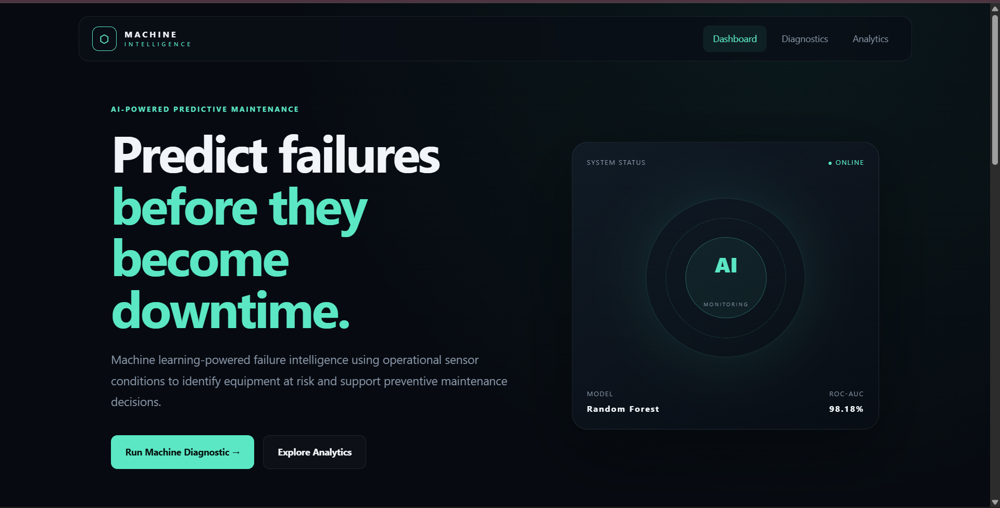
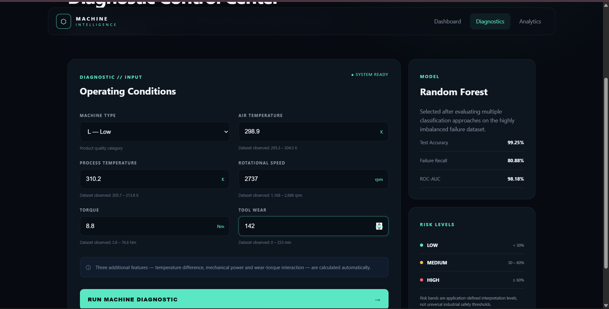
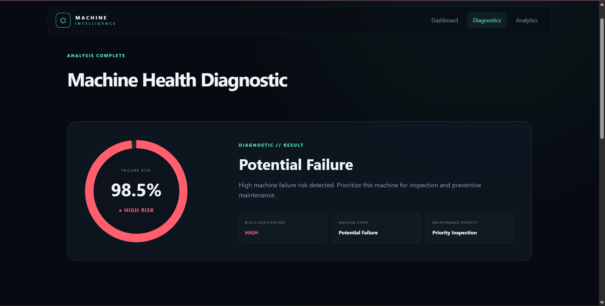
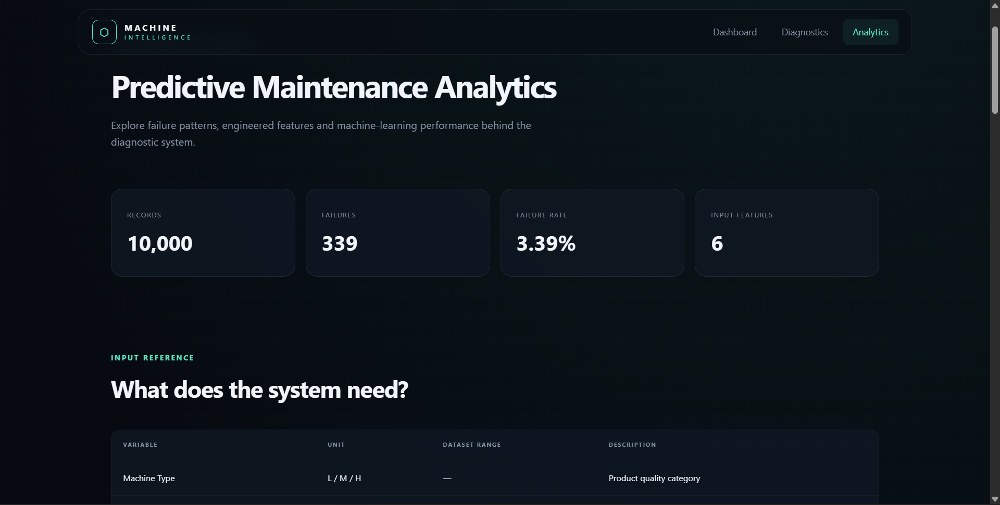

# Predictive Maintenance & Machine Failure Intelligence System

An end-to-end machine learning application for predicting equipment failure risk from operational machine conditions and supporting preventive maintenance decisions.

The project combines exploratory data analysis, feature engineering, imbalanced classification, model comparison, cross-validation, explainability, risk intelligence, and Flask-based deployment.

---

## Project Overview

Unexpected equipment failures can lead to production downtime, maintenance costs, and operational disruption.

This project develops a predictive maintenance system that analyzes machine operating conditions and estimates the likelihood of machine failure.

The final application allows users to enter current machine measurements and receive:

- Machine failure probability
- Low / Medium / High risk classification
- Predicted machine condition
- Maintenance priority
- Maintenance recommendation
- Engineered operating indicators

The application also contains an analytics dashboard explaining the dataset, failure patterns, model performance, feature importance, and validation results.

---

## Application Preview

### Dashboard



### Machine Diagnostic



### Failure Risk Analysis



### Analytics Dashboard



---

## Dataset

The project uses the **AI4I 2020 Predictive Maintenance Dataset**.

Dataset size:

- **10,000 machine observations**
- **339 machine failures**
- **3.39% failure rate**

The target variable is:

`Machine failure`

where:

- `0` = No machine failure
- `1` = Machine failure

Because only 3.39% of observations represent failures, the project is an **imbalanced binary classification problem**.

---

## Input Features

The deployed system requires six machine operating inputs:

| Input | Description |
|---|---|
| Machine Type | Product/machine quality category: L, M, or H |
| Air Temperature | Surrounding air temperature in Kelvin |
| Process Temperature | Machine process temperature in Kelvin |
| Rotational Speed | Rotational speed in rpm |
| Torque | Mechanical torque in Nm |
| Tool Wear | Accumulated tool wear in minutes |

---

## Feature Engineering

Three additional predictive features were created.

### Temperature Difference

```text
Process Temperature - Air Temperature
```

Represents the thermal difference between the machine process and surrounding environment.

### Mechanical Power

```text
Torque × Rotational Speed × 2π / 60
```

Provides an estimate of mechanical power under the current operating condition.

### Wear-Torque Interaction

```text
Tool Wear × Torque
```

Represents the interaction between accumulated tool wear and mechanical load.

The engineered features became important predictors in the final Random Forest model.

---

## Data Leakage Prevention

The original dataset contains failure-mode indicators:

- TWF — Tool Wear Failure
- HDF — Heat Dissipation Failure
- PWF — Power Failure
- OSF — Overstrain Failure
- RNF — Random Failure

These variables are strongly associated with recorded machine failure outcomes.

They were used during exploratory analysis but intentionally **excluded from predictive model features to prevent target leakage**.

Identifier columns such as `UDI` and `Product ID` were also excluded from model training.

---

## Exploratory Data Analysis

The analysis identified several differences between normal and failed machine observations.

| Measurement | Normal Average | Failure Average |
|---|---:|---:|
| Air Temperature | 299.974 K | 300.886 K |
| Process Temperature | 309.996 K | 310.290 K |
| Rotational Speed | 1540.26 rpm | 1496.49 rpm |
| Torque | 39.63 Nm | 50.17 Nm |
| Tool Wear | 106.69 min | 143.78 min |

Failed machines showed substantially higher average torque and tool wear, while average rotational speed was lower.

These relationships are observational and should not be interpreted as proof of causation.

---

## Machine Learning Models

The following classification approaches were evaluated:

1. Logistic Regression
2. Class-Weighted Logistic Regression
3. Random Forest
4. Class-Weighted Random Forest
5. Gradient Boosting

### Test Set Performance

| Model | Accuracy | Precision | Recall | F1 Score | ROC-AUC |
|---|---:|---:|---:|---:|---:|
| Logistic Regression | 96.75% | 57.14% | 17.65% | 26.97% | 92.55% |
| Balanced Logistic Regression | 85.90% | 17.96% | 88.24% | 29.85% | 93.84% |
| **Random Forest** | **99.25%** | **96.49%** | **80.88%** | **88.00%** | **98.18%** |
| Balanced Random Forest | 99.10% | 96.30% | 76.47% | 85.25% | 97.43% |
| Gradient Boosting | 99.30% | 100.00% | 79.41% | 88.52% | 96.87% |

Accuracy alone was not used for model selection because of the highly imbalanced target distribution.

Greater emphasis was placed on:

- Precision
- Failure recall
- F1-score
- ROC-AUC
- Precision-Recall performance
- Confusion matrix

---

## Final Model — Random Forest

Random Forest was selected as the final deployed model because it provided a strong balance between identifying actual failures and limiting false alarms.

### Held-Out Test Results

- **Accuracy:** 99.25%
- **Precision:** 96.49%
- **Recall:** 80.88%
- **F1 Score:** 88.00%
- **ROC-AUC:** 98.18%
- **PR-AUC:** 89.38%

### Confusion Matrix

```text
                 Predicted
              Normal   Failure

Actual Normal   1930       2
Actual Failure    13      55
```

The model correctly detected **55 of 68 machine failures** while generating only **2 false positive alerts** on the held-out test set.

---

## Cross-Validation

Stratified 5-fold cross-validation was used to evaluate model stability.

| Metric | Mean | Standard Deviation |
|---|---:|---:|
| Accuracy | 99.34% | ±0.16% |
| Precision | 97.80% | ±1.41% |
| Recall | 82.29% | ±4.47% |
| F1 Score | 89.32% | ±2.83% |
| ROC-AUC | 97.63% | ±1.30% |
| PR-AUC | 89.88% | ±2.24% |

The cross-validation results indicate that the model maintained strong performance across different subsets of the training data.

---

## Feature Importance

The most important Random Forest predictors were:

| Feature | Importance |
|---|---:|
| Mechanical Power | 21.53% |
| Wear-Torque Interaction | 21.53% |
| Rotational Speed | 16.60% |
| Torque | 12.81% |
| Temperature Difference | 11.56% |
| Tool Wear | 5.61% |
| Air Temperature | 3.77% |
| Process Temperature | 3.28% |
| Type L | 2.27% |
| Type M | 1.04% |

Feature importance represents predictive usefulness to the fitted model and does not establish causal relationships.

---

## Risk Intelligence

The Flask application converts model output into three application-level risk categories:

| Failure Probability | Risk Level | Suggested Action |
|---|---|---|
| < 30% | Low | Routine monitoring |
| 30% – 60% | Medium | Preventive inspection |
| ≥ 60% | High | Priority inspection |

These categories are application-defined interpretation bands and are **not universal industrial safety thresholds**.

---

## Application Features

### Machine Diagnostics

Users can enter:

- Machine type
- Air temperature
- Process temperature
- Rotational speed
- Torque
- Tool wear

The application automatically performs feature engineering and sends the resulting feature vector to the trained Random Forest model.

### Diagnostic Output

The system displays:

- Failure probability
- Machine risk level
- Predicted machine condition
- Maintenance priority
- Maintenance recommendation
- Calculated temperature difference
- Estimated mechanical power
- Wear-torque interaction

### Analytics Dashboard

The application includes an analytics interface containing:

- Dataset statistics
- Failure distribution
- Failure rate by machine type
- Normal vs failed operating conditions
- Feature importance
- Model comparison
- Cross-validation results
- Data leakage prevention explanation

---

## Tech Stack

### Data Science

- Python
- Pandas
- NumPy
- Scikit-learn
- Matplotlib
- Jupyter Notebook

### Web Application

- Flask
- HTML5
- CSS3
- JavaScript
- Chart.js

### Machine Learning

- Logistic Regression
- Random Forest
- Gradient Boosting
- Stratified Cross-Validation
- Classification Metrics

---

## Project Workflow

```text
Data Collection
      ↓
Data Understanding
      ↓
Data Validation & Cleaning
      ↓
Exploratory Data Analysis
      ↓
Feature Engineering
      ↓
Leakage Prevention
      ↓
Train/Test Split
      ↓
Model Comparison
      ↓
Imbalance Evaluation
      ↓
Cross-Validation
      ↓
Final Model Selection
      ↓
Failure Risk Intelligence
      ↓
Flask Deployment
```

---

## Run Locally

### 1. Clone the repository

```bash
git clone YOUR_REPOSITORY_URL
```

### 2. Open the project

```bash
cd predictive-maintenance-system
```

### 3. Create a virtual environment

Windows:

```bash
python -m venv venv
venv\Scripts\activate
```

### 4. Install dependencies

```bash
pip install -r requirements.txt
```

### 5. Start the Flask application

```bash
python app.py
```

Open:

```text
http://127.0.0.1:5000
```

---

## Example Failure Detection

A known failure observation was tested through the deployed application:

```text
Machine Type: L
Air Temperature: 298.9 K
Process Temperature: 310.2 K
Rotational Speed: 2737 rpm
Torque: 8.8 Nm
Tool Wear: 142 min
```

The deployed application returned:

```text
Failure Risk: 98.50%
Risk Level: HIGH
Predicted Condition: Potential Failure
Maintenance Priority: Priority Inspection
```

This matched the prediction obtained in the modeling notebook, verifying consistency between model development and Flask deployment preprocessing.

---

## Limitations

- The model was trained on the AI4I 2020 dataset and has not been validated on live industrial machinery.
- Risk categories are application-defined rather than industrial safety thresholds.
- Feature importance should not be interpreted as causal evidence.
- Real-world predictive maintenance systems would require continuous sensor data, production validation, monitoring, and periodic model retraining.

---

## Author

**Kishor Kumar M**

Artificial Intelligence and Machine Learning Graduate  
Data Analytics | Data Science | Machine Learning

GitHub: `kishorkumar-cmkk`

---

## Disclaimer

This project is intended for educational, portfolio, and analytical demonstration purposes. Model predictions should not be used as a substitute for professional industrial maintenance or safety assessment.